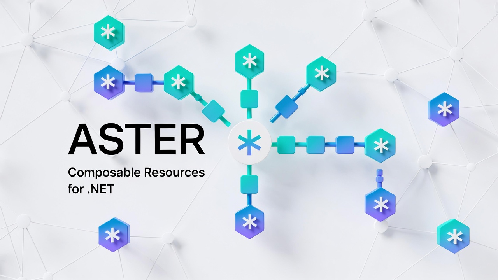

# Aster

[](https://github.com/valence-works/aster/actions/workflows/ci.yml)



**Aster** is a .NET SDK for defining, versioning, and querying composable resources using a **Resource → Aspect → Facet** model.

It provides a headless, backend-agnostic foundation for attaching reusable, cross-cutting capabilities (Tags, Owner, RBAC, Scheduling, …) to any resource type — without hard-coding every entity from scratch.

> **Status:** Pre-1.0. Core SDK, in-memory engine, SQLite JSON persistence/querying, query capability discovery and validation, typed query helpers, provider conformance support, portable operators, explicit index projection contracts, definition schema upgrades, portability primitives, host lifecycle hooks, tenant scoping, policies and lifecycle markers, version history, and facet validation/UI metadata are available. Aster Studio (`src/apps/Aster.Studio`) is the reference host. Work toward 1.0 is tracked in the [Aster 1.0 program](https://github.com/valence-works/aster/issues/58).

---

## Table of Contents

- [Concepts](#concepts)
- [Installation](#installation)
- [Quick Start](#quick-start)
- [DI Registration](#di-registration)
- [Querying](#querying)
- [Versioning & Activation](#versioning--activation)
- [Typed Aspects & Facets](#typed-aspects--facets)
- [Project Structure](#project-structure)
- [Roadmap](#roadmap)
- [Contributing](#contributing)
- [License](#license)

---

> **Scope:** Aster is a control-plane store for authored, versioned configuration and domain objects, not for runtime or high-throughput data. See [ADR 0001](docs/adr/0001-control-plane-boundary.md).

## Concepts

| Term | Description |
|---|---|
| **Resource Definition** | The schema for a resource type (e.g. `Product`, `WorkflowDefinition`). Immutable — each update appends a new definition version. |
| **Resource** | A versioned instance of a Resource Definition. `ResourceId` is stable across versions; `Id` identifies the exact version snapshot. |
| **Aspect Definition** | A reusable "part" that can be attached to any Resource Definition (e.g. `TitleAspect`, `PriceAspect`). |
| **Aspect Instance** | The per-resource-version data for an attached aspect, stored as a dictionary of facet values. |
| **Facet Definition** | A typed field declared inside an Aspect Definition (e.g. `Title: string`, `Amount: decimal`). |
| **Facet Value** | The actual value of a facet on an aspect instance. |
| **Activation Channel** | A named delivery context (e.g. `"Published"`, `"Staging"`). A resource version becomes _active_ when placed in a channel. Multiple channels and multiple simultaneously active versions are supported. |
| **Tenant Scope** | An explicit opaque tenant boundary for definitions, resources, activation state, queries, schema upgrades, portability, and lifecycle hooks. Omitted scope resolves to the default single-tenant scope. |

Resources follow an **append-only versioning model** — versions are never mutated. A version with no activation entry is implicitly a draft.

---

## Installation

```bash
dotnet add package Aster.Core
dotnet add package Aster.Persistence.SqliteJson   # optional: SQLite persistence
dotnet add package Aster.Persistence.PostgresJsonb # optional: PostgreSQL persistence
```

Packages target .NET 8, 9 and 10. Until 1.0 they are published as `0.x` releases and the API may change between minor versions.

## Quick Start

### 1. Register services (ASP.NET Core / Generic Host)

```csharp
builder.Services.AddAsterCore();
```

This registers the in-memory store, resource manager, query service, typed aspect/facet binders, and identity generator.

For SQLite-backed persistence and querying, call `AddAsterSqliteJson(...)` after `AddAsterCore()`:

```csharp
builder.Services.AddAsterCore();
builder.Services.AddAsterSqliteJson(options =>
{
    options.ConnectionString = "Data Source=aster.db";
});
```

For PostgreSQL, call `AddAsterPostgresJsonb(...)` instead. Until the Postgres query translator lands (#98), queries run through the in-memory query service over Postgres reads.

```csharp
builder.Services.AddAsterCore();
builder.Services.AddAsterPostgresJsonb(options =>
{
    options.ConnectionString = "Host=localhost;Database=aster;Username=aster;Password=...";
});
```

### 2. Define a Resource Type

```csharp
using Aster.Core.Definitions;

// Plain C# records become typed aspects
private record TitleAspect(string Title);
private record PriceAspect(decimal Amount, string Currency);

var definition = new ResourceDefinitionBuilder()
    .WithDefinitionId("Product")
    .WithAspect<TitleAspect>()
    .WithAspect<PriceAspect>()
    .Build();

await definitionStore.RegisterDefinitionAsync(definition);
```

For tenant-aware hosts, pass a `TenantScope` explicitly:

```csharp
var tenant = TenantScope.FromTenantId("tenant-a");
await definitionStore.RegisterDefinitionAsync(definition, tenant, CancellationToken.None);
```

### 3. Create a Resource

```csharp
var resource = await manager.CreateAsync("Product", new CreateResourceRequest
{
    TenantScope = tenant, // omit for default single-tenant behavior
    InitialAspects = new Dictionary<string, object>
    {
        ["TitleAspect"] = new TitleAspect("Super Gadget"),
        ["PriceAspect"] = new PriceAspect(99.99m, "USD"),
    }
});
// resource.Version == 1, no activation entry → implicitly draft
```

### 4. Update (Save a New Version)

```csharp
var v2 = await manager.UpdateAsync(resource.ResourceId, new UpdateResourceRequest
{
    BaseVersion = resource.Version,   // optimistic lock
    AspectUpdates = new Dictionary<string, object>
    {
        ["TitleAspect"] = new TitleAspect("Super Gadget Pro"),
    }
});
// v2.Version == 2
```

### 5. Activate in a Channel

```csharp
await manager.ActivateAsync(resource.ResourceId, version: 2, channel: "Published");
```

### 6. Read Back with Typed Aspects

```csharp
var latest = await manager.GetLatestVersionAsync(resource.ResourceId);

var title = latest!.GetAspect<TitleAspect>("TitleAspect", binder);
Console.WriteLine(title?.Title); // "Super Gadget Pro"
```

---

## DI Registration

`AddAsterCore()` wires the following services:

| Interface | Default Implementation |
|---|---|
| `IResourceDefinitionStore` | `InMemoryResourceDefinitionStore` |
| `IResourceManager` | `DefaultResourceManager` |
| `IResourceVersionWriter` | `InMemoryResourceStore` |
| `IResourceVersionReader` | `InMemoryResourceStore` |
| `IResourceQueryService` | `InMemoryQueryService` |
| `IResourceQueryCapabilitiesProvider` | `InMemoryQueryCapabilitiesProvider` |
| `IResourceQueryValidator` | `ResourceQueryValidator` |
| `IResourceSchemaVersionService` | `ResourceSchemaVersionService` |
| `ITypedAspectBinder` | `SystemTextJsonAspectBinder` |
| `ITypedFacetBinder` | `SystemTextJsonFacetBinder` |
| `IIdentityGenerator` | `GuidIdentityGenerator` |

All services are registered as **singletons** — the in-memory store is the single shared instance within the process.

---

## Querying

Use `IResourceQueryService` with a portable `ResourceQuery` AST:

```csharp
var query = new ResourceQuery
{
    TenantScope = tenant,
    DefinitionId = "Product",
    Filter = new FacetValueFilter("TitleAspect", "Title", "Gadget", ComparisonOperator.Contains),
    Sorts = [new SortExpression("Created", SortDirection.Descending)],
    Skip = 0,
    Take = 20,
};

var results = await queryService.QueryAsync(query);
```

Both built-in providers (in-memory and SQLite JSON) execute the same `ResourceQuery` AST:

- Version scopes: latest, all versions, active (per channel), and draft.
- Filters: metadata, aspect presence, facet values, lifecycle state, and `And`/`Or`/`Not` composition.
- Metadata operators: `Equals`, `NotEquals`, `In`, `Contains`, `StartsWith`.
- Facet operators: `Equals`, `NotEquals`, `In`, `Contains`, `StartsWith`, `Range` (numeric and date-like), `Exists`.
- Metadata and facet sorting, plus `Skip`/`Take` paging.

The SQLite JSON provider does not support metadata range filters. Unsupported query shapes fail validation, and execution throws `UnsupportedQueryFeatureException`.

Inspect provider support and validate before execution:

```csharp
var capabilities = serviceProvider.GetRequiredService<IResourceQueryCapabilitiesProvider>().Capabilities;
var validation = serviceProvider.GetRequiredService<IResourceQueryValidator>().Validate(query);
```

Typed helpers build the same portable query model without repeating common aspect/facet strings:

```csharp
var filter = TypedQuery.For<TitleAspect>()
    .Facet(x => x.Title)
    .Contains("Gadget");
```

---

## Versioning & Activation

- **Immutable versions** — every call to `UpdateAsync` appends a new version.
- **Definition lineage** — every new resource records the active `ResourceDefinition.Version` in `Resource.DefinitionVersion`. Normal updates preserve that recorded lineage.
- **Optimistic concurrency** — `UpdateResourceRequest.BaseVersion` must match the current latest; mismatches throw `ConcurrencyException`.
- **Activation** — `ActivateAsync(resourceId, version, channel, allowMultipleActive)`:
  - `allowMultipleActive = false` (default): deactivates all other versions in the channel first.
  - `allowMultipleActive = true`: adds alongside existing active versions.
- **Retrieval helpers** on `IResourceManager`:
  - `GetLatestVersionAsync` — the most recently created version.
  - `GetVersionAsync(resourceId, version)` — a specific version snapshot.
  - `GetVersionsAsync(resourceId)` — all versions.
  - `GetActiveVersionsAsync(resourceId, channel)` — all active versions in a channel.

Use `IResourceSchemaVersionService` when a host needs to inspect or explicitly advance definition lineage:

```csharp
var schemaVersions = serviceProvider.GetRequiredService<IResourceSchemaVersionService>();
var status = await schemaVersions.GetSchemaStatusAsync(resource);

var upgrade = await schemaVersions.UpgradeAsync(resource.ResourceId, new ResourceSchemaUpgradeRequest
{
    BaseVersion = resource.Version,
    TargetDefinitionVersion = status.LatestDefinitionVersion,
});
```

Schema status is evaluated for one resource version at a time. Explicit upgrades append a new resource version, default to the latest definition version when no target is supplied, preserve existing aspect data by default, and report `CarriedForwardAspectKeys` for aspect keys not declared by the target definition. A target equal to the source lineage returns `ResourceSchemaUpgradeStatus.NoOp`; invalid targets throw `ResourceSchemaUpgradeException` with a stable `Code`.

### Exception reference

| Exception | When thrown |
|---|---|
| `ConcurrencyException` | `BaseVersion` mismatch on update or activate |
| `VersionNotFoundException` | Requested version does not exist |
| `ResourceSchemaUpgradeException` | Explicit schema upgrade target is invalid or unavailable |
| `SingletonViolationException` | Creating a second instance of a singleton definition |
| `DuplicateResourceIdException` | Caller-supplied `ResourceId` already exists |
| `DuplicateAspectAttachmentException` | Same aspect key attached twice to a definition |

---

## Typed Aspects & Facets

Any C# class or record can be used as a typed aspect:

```csharp
record PriceAspect(decimal Amount, string Currency);
```

**Read** a typed aspect from a resource:

```csharp
var price = resource.GetAspect<PriceAspect>("PriceAspect", binder);
```

**Write** a typed aspect (returns a new immutable `Resource` record — State Replace semantics):

```csharp
var updated = resource.SetAspect("PriceAspect", new PriceAspect(129.99m, "USD"), binder);
```

The same pattern works at the **facet level** via `AspectInstance.GetFacet<T>` and `AspectInstance.SetFacet<T>`.

The default `ITypedAspectBinder` implementation uses `System.Text.Json`.

---

## Project Structure

```
src/
  core/
    Aster.Core/              ← Main SDK library (net8.0 / net9.0 / net10.0)
      Abstractions/          ← Interfaces (IResourceManager, IResourceDefinitionStore, …)
      Definitions/           ← ResourceDefinitionBuilder (fluent API)
      Exceptions/            ← Typed exceptions
      Extensions/            ← DI helpers, GetAspect / SetAspect extensions
      InMemory/              ← In-memory implementations
      Models/                ← Domain models (Resource, AspectDefinition, ResourceQuery, …)
      Services/              ← SystemTextJson binders, GuidIdentityGenerator
  persistence/
    Aster.Persistence.SqliteJson/
      ← SQLite JSON definition/resource version/query provider
    Aster.Persistence.PostgresJsonb/
      ← PostgreSQL jsonb definition/resource version provider
    Relational/              ← Store core shared by the relational providers (linked source, ADR 0004)
  hosting/
    Aster.AspNetCore/        ← Mountable minimal-API endpoints (MapAster) with ProblemDetails and OpenAPI
  apps/
    Aster.Studio/            ← Aster Studio: the reference host (ASP.NET Core + React SPA)
test/
  Aster.Tests/               ← xUnit tests (unit + integration)
  Aster.AspNetCore.Tests/    ← HTTP integration tests for Aster.AspNetCore (TestServer)
docs/                        ← Architecture review, coding conventions, roadmap
specs/                       ← Feature specs (001-core-sdk-foundation, …)
```

---

## Roadmap

Execution is tracked in the [Aster 1.0 program](https://github.com/valence-works/aster/issues/58), a hierarchy of GitHub issues (program → epics → tasks):

| Phase | Focus | Epics |
|---|---|---|
| **A** | Reset & foundation | Delivery process, CI/packaging/API stability, Elsa consumer spike |
| **B** | Model completeness | Facet types (guid, arrays, object), resource references, shared aspect definitions |
| **C** | Production readiness | PostgreSQL JSONB provider, performance & scale |
| **D** | Integration & experience | JSON Schema export and `Aster.AspNetCore`, Aster Studio, Elsa integration, reference samples |

[`docs/Roadmap.md`](docs/Roadmap.md) remains the architecture narrative; [`docs/ExecutionRoadmap.md`](docs/ExecutionRoadmap.md) records the slices that have landed.

### Packages

Current: `Aster.Core`, `Aster.Persistence.SqliteJson`, `Aster.Persistence.PostgresJsonb` (stores; its query translator is #98), `Aster.AspNetCore`.

Splitting `Aster.Core` into smaller packages is deferred.

---

## Contributing

Please read [`docs/coding-conventions.md`](docs/coding-conventions.md) before submitting a PR.

---

## License

MIT — see [`LICENSE`](LICENSE).
